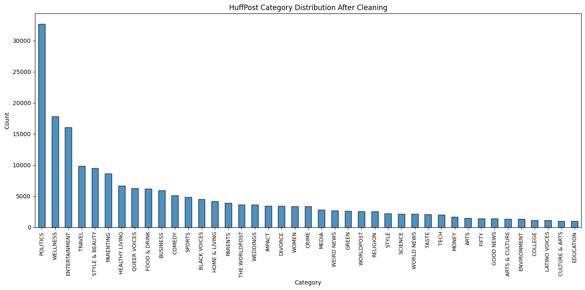
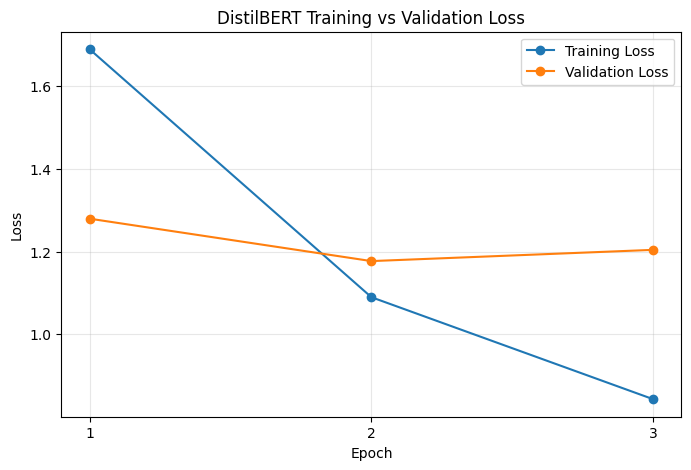
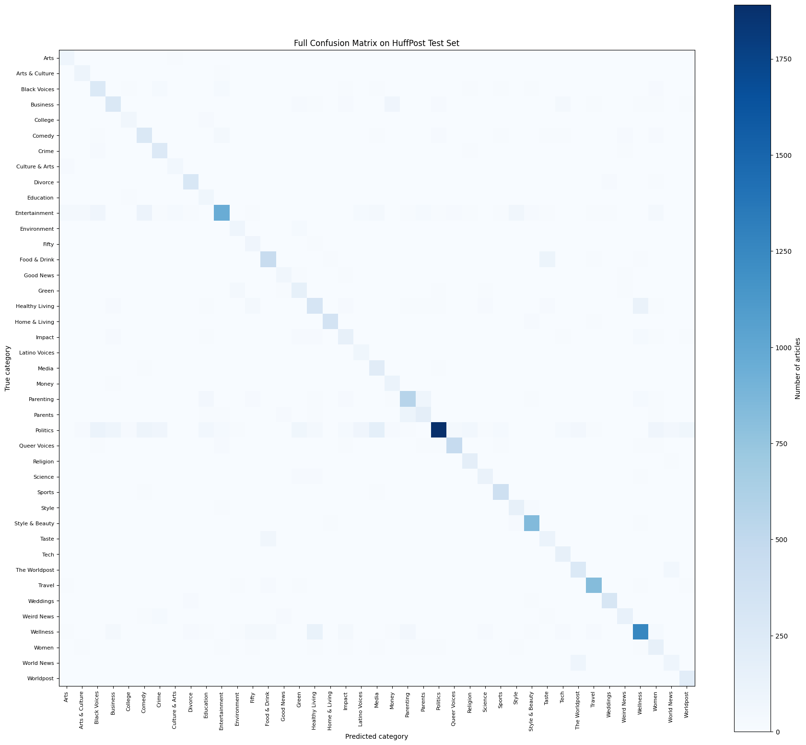

# News Topic Classification with DistilBERT

Classifying 200,000 HuffPost news articles into 41 topic categories, comparing simple neural baselines with a fine-tuned transformer, and digging into *why* the model makes the mistakes it does.

Team project for **DX703 Advanced Machine Learning & AI**, Boston University (M.S. Data Science), Spring 2026.
Team: Lucy Bing, Lisa-Marie Bennett, Ikechi Mbeyi.

**Stack:** Python, TensorFlow/Keras, KerasHub (DistilBERT), Hugging Face Datasets & Tokenizers, scikit-learn, pandas, matplotlib

---

## The problem

Given a news headline and its short description, predict which of 41 categories the article belongs to (POLITICS, WELLNESS, TRAVEL, PARENTING, and so on). The same kind of task powers automatic article tagging, feed organization and content moderation: route each piece of text to the right category, at scale.

**Data:** [HuffPost News Category Dataset](https://huggingface.co/datasets/khalidalt/HuffPost), 200,853 articles. Input = `headline [SEP] short_description`.

## What the data looked like

Before modeling, we audited the data, and it had real problems:

| Issue | What we found |
|---|---|
| Class imbalance | POLITICS has 32,739 articles; EDUCATION has 1,004 (9.6x the median class) |
| Missing text | 9.8% of articles have no short description |
| Duplicates | 98 exact duplicate rows, 488 duplicate texts |
| Conflicting labels | 15 identical texts labeled with *different* categories |
| Overlapping categories | PARENTS vs PARENTING, WELLNESS vs HEALTHY LIVING, ARTS vs ARTS & CULTURE vs CULTURE & ARTS, WORLD NEWS vs THE WORLDPOST |



**Cleaning and setup**
- Removed empty rows, conflicting-label texts and duplicates, and deduplicated **before** splitting so no article appears in both training and test data (verified: zero overlap).
- Stratified 80/10/10 train/validation/test split with a fixed seed.
- Chose a **128-token** max length from tokenizer analysis: it truncates 0.11% of samples, versus 9.7% at 64 tokens.
- Primary metric **macro-F1**, because accuracy alone hides poor performance on small classes.

## Models compared

| Model | Test accuracy | Test macro-F1 |
|---|---|---|
| Baseline: embedding + average pooling | 0.527 | 0.449 |
| Custom CNN: embedding + Conv1D + dual pooling | 0.534 | 0.462 |
| **Fine-tuned DistilBERT** | **0.709** | **0.604** |

Averaging word embeddings loses word order, and a single convolution layer adds little. The pretrained transformer understands context, which gave the biggest jump. Training took about 10.5 minutes on a GPU, compared with under a minute for the smaller models, which was well worth it.

DistilBERT setup: full fine-tuning, Adam at 2e-5, batch size 32, early stopping on validation loss (best at epoch 2).

## Final run with class weights

For the final notebook we retrained DistilBERT with **balanced class weights** to push the model toward the small categories.

| Final model (class-weighted) on 20,035 held-out articles | |
|---|---|
| Accuracy | 0.649 |
| Macro-F1 | 0.581 |
| Weighted-F1 | 0.659 |



**What class weighting did:** it lowered overall accuracy and macro-F1 compared with the unweighted run. Small classes gained recall, but precision dropped. For example, EDUCATION recall was 0.69 but precision only 0.25. Large classes also lost recall: POLITICS precision stayed high (0.93), but recall fell to 0.58 as political stories got pushed into MEDIA, BLACK VOICES and COMEDY. For this dataset, the unweighted model was the better trade-off, and I'd test milder weighting or threshold tuning next.

## Where the model goes wrong



The most common errors are the overlapping categories we flagged in the data audit:

| True category | Predicted | Count |
|---|---|---|
| WELLNESS | HEALTHY LIVING | 126 |
| HEALTHY LIVING | WELLNESS | 125 |
| FOOD & DRINK | TASTE | 102 |
| PARENTS | PARENTING | 98 |
| WORLD NEWS | THE WORLDPOST | 85 |
| PARENTING | PARENTS | 84 |

Best categories (F1): STYLE & BEAUTY 0.88, TRAVEL 0.84, HOME & LIVING 0.84, WEDDINGS 0.83.
Hardest: EDUCATION 0.37, FIFTY 0.38, WORLD NEWS 0.39, WOMEN 0.39.

## What I took away

**A big share of the remaining errors are data problems, not model problems.** When categories like WELLNESS and HEALTHY LIVING overlap so much that people would also struggle to separate them, no model can learn a clean boundary. Better results here would come from fixing the label set, for example merging or redefining overlapping categories, as much as from a bigger model. This is the same reason I care about clear labeling guidelines in human data and content safety work: unclear labels become noisy training data.

## Run it

```bash
pip install -r requirements.txt
jupyter notebook news_classifier_distilbert.ipynb
```

The notebook downloads the dataset from Hugging Face. A GPU is recommended for DistilBERT. We used Google Colab.
